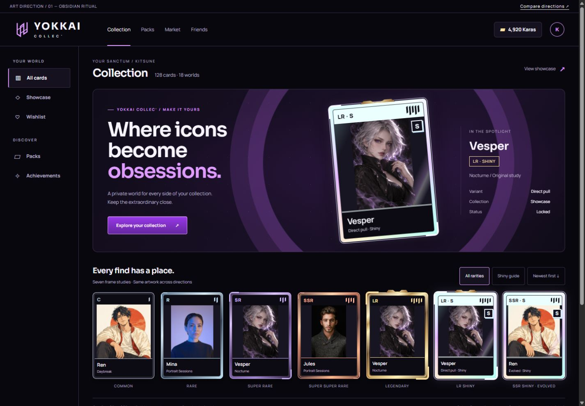
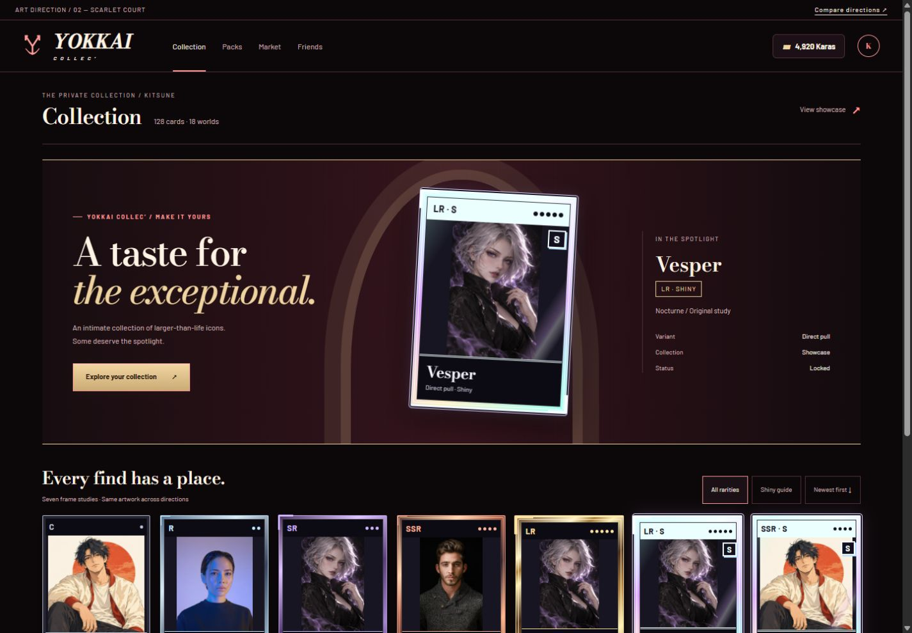
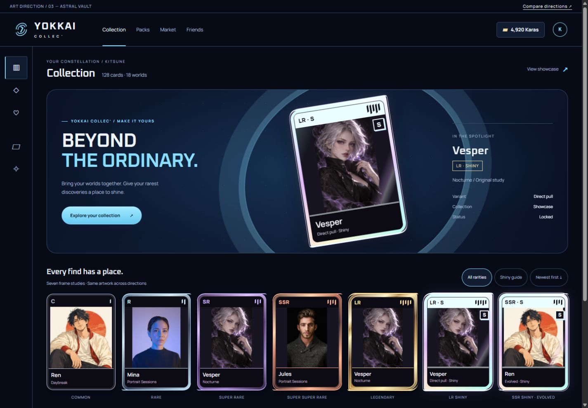

# Yokkai Collec’ — L’envoûtement, avant le mouvement

Phase 1, nouvelle proposition · 16 octobre 2026 · Aucun code de production.

## Le brief retenu

Walid a rejeté les trois premières pistes : trop sages et trop proches d’un même habillage. La nouvelle demande porte sur **la charte graphique elle-même**, pas sur une ouverture de booster : dès l’arrivée, le site doit donner envie de pénétrer dans son univers et de posséder ses cartes. Le registre est celui du gacha et du casino premium : contraste, richesse des matières, lumière, objets précieux, hiérarchie immédiatement perceptible.

Les maquettes montrent donc **la collection**, une vitrine LR Shiny et les sept cadres à l’arrêt. Les boosters sont présents comme objets graphiques secondaires. Pas de vidéo, de son ni de séquence de révélation pour faire passer la direction. Les données sont fictives et les raccourcis de navigation sont des ancres de présentation.

[Comparer les directions](index.html) · [Obsidian Ritual](obsidian.html) · [Scarlet Court](scarlet.html) · [Astral Vault](astral.html)

## 01 — Obsidian Ritual · Recommandée

**Concept.** Un sanctuaire nocturne où les icônes de toutes les cultures deviennent des objets que l’on veut garder près de soi. Le noir sculpté, l’orchidée électrique et les tranches métalliques donnent une sensation de puissance contenue ; le prestige se concentre sur les cartes.

**Mood.** Obsidienne polie, flacons de parfumerie de niche, lumière de scène, bijoux d’architecture et coffrets laqués. La géométrie est une gravure contemporaine, pas un alphabet magique emprunté ni une reproduction de carte existante.

| Rôle                   | Couleur               | Intention                          |
| ---------------------- | --------------------- | ---------------------------------- |
| Fond                   | `#08070D`             | Noir encré, profondeur             |
| Surface                | `#15111F`             | Plan relevé, navigation            |
| Trait structurel       | `#382C47`             | Séparer sans éclairer tout l’écran |
| Texte                  | `#F8F5FF`             | Blanc légèrement froid             |
| Secondaire             | `#BCB2CC`             | Lecture calme                      |
| Signature de matière   | `#7D369B`             | Violet saturé, décor uniquement    |
| Accent lisible / focus | `#DF9BFF`             | Titres ponctuels, sélection, focus |
| Action                 | `#9A38E9` → `#64279F` | Émail électrique, texte `#FFF5FF`  |
| Métal / Karas          | `#FFE1A1`             | Champagne chaud, rareté LR         |

**Typographie.** Sora 500/600/700 pour titres et signature, Manrope 400/500/600/700 pour interface et noms de cartes. Google Fonts, SIL OFL 1.1. Le logo serre les lettres tout en gardant une assise horizontale ferme ; les petites légendes restent ouvertes et lisibles. Les caractères non latins conservent leurs noms et utilisent les fontes de repli adaptées, jamais une translittération imposée par la DA.

**Logo.** Trois montants décalés, deux liaisons obliques : un emblème original qui évoque un passage et un assemblage. Pas de visage de renard générique, de boule, de blason héraldique ni de mascotte à ce stade. La signature `YOKKAI / COLLEC’` est stable et compacte. L’emblème est dessiné en SVG dans la maquette ; sa version définitive attend la sélection.

**Carte.** Tranche noire fine en C, métal argent en R, facettes et trois encoches en SR, double enveloppe cuivre en SSR, métal champagne et crête découpée en LR. Le Shiny devient un objet clair au milieu du noir : tranche spectrale, rail ivoire glacé, sceau `S` dédoublé et provenance persistante. Les cinq niveaux gardent leurs lettres et un à cinq traits de taille lisible.

**Booster / dos.** Regular : sachet noir-violet laqué, grand emblème, soudures argentées. Decision : même famille matérielle, cinq fentes dont une pleine et couture pointillée champagne, reconnaissance possible sans couleur. Dos envisagé : emblème sur une plaque noire décentrée avec trois rainures interrompues ; aucune spirale ou rosace reprise d’un jeu.

**Animation future.** Reflet d’émail unique au survol de la carte active, 180 ms ; métal qui s’assemble à la révélation, 250–700 ms selon rareté ; traversée spectrale unique de 900 ms pour Shiny. Aucun mouvement permanent dans les grilles. Mouvement réduit : objets déjà posés, matière et sceau fixes.

**Pourquoi la retenir.** C’est la synthèse la plus directe du brief : nocturne, magnétique, précieuse et clairement jeu, sans rendre le marché et les échanges difficiles à lire. Le risque à surveiller est l’excès de violet : limiter l’éclairage à la vitrine, au logo et aux actions, garder les autres pages presque noires.

## 02 — Scarlet Court

**Concept.** Un salon privé pour une collection exceptionnelle, plus sensuel que technologique. La laque noire, le velours scarlet et le champagne construisent une opulence silencieuse dont les cartes sont les pièces maîtresses.

**Mood.** Écrins joailliers, intérieur de théâtre, affiche d’opéra contemporaine, façonnage de flacons et estampage à chaud. Le caractère casino vient de la matière et de la lumière ; aucune roulette, aucun jeton ni symbole de jeu de cartes standard ne devient l’identité.

| Rôle                 | Couleur               | Intention                            |
| -------------------- | --------------------- | ------------------------------------ |
| Fond                 | `#0C0709`             | Noir chaud                           |
| Surface              | `#1B1015`             | Profondeur de laque                  |
| Trait structurel     | `#543038`             | Filet discret                        |
| Texte                | `#FFF4E5`             | Ivoire                               |
| Secondaire           | `#D0B7B9`             | Rose poudré lisible                  |
| Signature de matière | `#8C253C`             | Rouge profond, décor                 |
| Accent / focus       | `#FF9B99`             | Rouge clair accessible               |
| Action               | `#F2D5A2` → `#CAAB75` | Estampage champagne, texte `#24150C` |
| Métal / Karas        | `#EFD3A0`             | Or pâle                              |

**Typographie.** Bodoni Moda 500/600, italique 500 pour titres et signature ; Barlow 400/500/600/700 pour l’interface. Google Fonts, SIL OFL 1.1. Bodoni est réservée aux tailles généreuses ; Barlow doit remplacer les noms de carte en très petite vignette si la finesse gêne la lecture.

**Logo.** Un Y à branches fendues, terminé par deux courbes ouvertes, donne une marque de joaillier originale. Le mot-symbole est plus contrasté et légèrement incliné. Il doit garder une version simple à 24 px ; pas de couronne illustrée, d’écusson ou de sceau de franchise.

**Carte.** Angles nets, bord supérieur et inférieur plus épais, filets d’estampage et une à cinq petites perforations rondes accompagnant les lettres. Le prestige vient d’une matière de plus en plus épaisse, pas de l’ajout de statistiques ou d’un bandeau de combat. Le Shiny utilise une feuille optique claire, une double enceinte et le même sceau `S`, sans recolorer les images.

**Booster / dos.** Sachet à sommet en arche, noir et bordeaux, signature estampée ; Decision à couture discontinue et cinq fentes. Dos : Y ouvert sur un aplat bordeaux et deux filets parallèles interrompus. Les deux packs portent explicitement leur nom et `05` / `01` comme repères secondaires.

**Animation future.** Réflexion douce de laque sur la pièce active, 200 ms ; estampage du bord en 300 ms ; SSR/LR plus profonds en 500–700 ms, Shiny en 850 ms. Aucun tremblement d’écran ni boucle lumineuse. Réduction du mouvement : estampage final immobile.

**Pourquoi la choisir.** La piste la plus luxueuse et la plus inattendue pour mêler Kpop, cinéma et anime. Son risque est de sembler trop adulte ou éditoriale pour certaines communautés : vérifier le logo et les noms en petite taille avant de la retenir.

## 03 — Astral Vault

**Concept.** Un coffre optique où les personnages de mondes différents deviennent les éléments d’une même constellation personnelle. L’interface est un instrument de découverte nocturne ; ses cartes sont des fragments d’énergie conservés dans une enveloppe de métal et de lumière.

**Mood.** Verre de précision, instruments optiques, installations immersives, rainures de métal brossé et éclairage bleu de galerie. La géométrie orbitale reste abstraite, sans cockpit ou décor de science-fiction qui imposerait une franchise à toutes les cartes.

| Rôle                 | Couleur               | Intention                       |
| -------------------- | --------------------- | ------------------------------- |
| Fond                 | `#060B16`             | Nuit bleue                      |
| Surface              | `#111C30`             | Plan technique                  |
| Trait structurel     | `#304965`             | Séparation                      |
| Texte                | `#EFF5FF`             | Blanc froid                     |
| Secondaire           | `#AEBFD9`             | Métadonnées                     |
| Signature de matière | `#23619B`             | Bleu chargé, décor              |
| Accent / focus       | `#8ADFFF`             | Glace électrique                |
| Action               | `#A2EAFF` → `#67C9F1` | Lumière pleine, texte `#081625` |
| Métal / Karas        | `#F0D8A2`             | Champagne de contraste          |

**Typographie.** Oxanium 500/600/700 pour titres et signature, Manrope 400/500/600/700 pour lecture. Google Fonts, SIL OFL 1.1. L’angle technologique appartient aux grands titres ; les noms propres gardent la neutralité de Manrope.

**Logo.** Quatre segments optiques ouverts encadrent une encoche centrale oblique ; le dessin reste asymétrique et original. Les grandes orbites appartiennent à la vitrine, pas au contour de chaque bouton.

**Carte.** Angles opposés différenciés, traverses courbes et un à cinq segments obliques. Les cadres montent du métal sombre à une enceinte plus large et gravée. Le Shiny reprend la signature claire et dédoublée, mais ses lèvres optiques se détachent du contour : reconnaissance possible même quand le spectre ne se voit pas.

**Booster / dos.** Pochette bleue à deux coins opposés arrondis, embossage argent ; Decision cinq fentes et couture pointillée. Dos : segments optiques séparés et encoche centrale sur fond de nuit. Aucun orbite sphérique avec bouton central.

**Animation future.** Reflet mobile sur une seule carte active, 160 ms ; réunion des segments en 250–650 ms, séparation spectrale de 900 ms pour Shiny. Transformation et opacité seulement, aucun brouillard animé. Réduction du mouvement : segments déjà assemblés et spectre fixe.

**Pourquoi la choisir.** La plus immédiatement numérique et la plus adaptée à une collection rapide sur mobile. Le risque : se rapprocher d’un tableau de bord spatial générique ; garder la lumière au service des portraits et préserver une marque compacte.

## Le contrat image, commun aux trois directions

L’objet est riche, **l’image reste elle-même**. On ne doit pas avoir besoin de repeindre les photos en anime pour que la charte fonctionne.

- Ratio extérieur 5:7. Trois zones : rail opaque de rareté, fenêtre d’image normalisée, cartouche opaque de nom et de franchise. Aucun texte essentiel directement sur une image inconnue.
- `object-fit: contain` par défaut : le dessin carré clair garde toute sa composition, la photo sombre garde son sujet, les formats restants montrent un passe-partout neutre. Pas d’arrière-plan flouté coûteux ni de filtre coloré global.
- `cover` seulement pour une image dont le point focal a été validé éditorialement. Les maquettes n’utilisent pas cette exception pour les cartes ; les miniatures de captures du comparateur sont des captures d’interface, pas des illustrations recadrées.
- Masque uniquement aux coins de la fenêtre. Liseré et reflets au bord : pas de bande noire ni de foil opaque sur les yeux. Le reflet Shiny reste cantonné aux bords latéraux.
- Les noms longs auront deux lignes maximum en vignette et leur version entière en détail/zoom et nom accessible ; les franchises et noms propres ne se traduisent pas. Les textes joueur, alt et aria sont en anglais.
- Images indisponibles : conserver l’emplacement et afficher le nom et une silhouette abstraite originale ; ne pas remplacer un portrait par un booster. Le repli métier sera réalisé en phase 2, pas simulé par une nouvelle logique dans ces maquettes statiques.
- La même structure servira aux rendus vignette/détail/zoom et OG. Le rendu OG utilise une matière statique et les fontes embarquées ; pas de halo animé qui disparaît au partage.

Les sept cartes permettent de comparer explicitement C, R, SR, SSR, LR, LR Shiny de tirage et SSR Shiny évoluée. Les mêmes images sont répétées pour isoler le travail du cadre : **une Vesper LR et une Vesper SR ont la même illustration**. Le Shiny n’est pas une rareté supplémentaire. Aucun SSR Shiny de tirage n’est suggéré et le quota du Decision Pack reste un par jour.

## Rareté et accessibilité

| Niveau    | Indice non chromatique                                          | Matière de base                 |
| --------- | --------------------------------------------------------------- | ------------------------------- |
| C         | Lettre C, un trait/perforation, enceinte simple                 | Mat                             |
| R         | Lettre R, deux marques, coins renforcés                         | Argent                          |
| SR        | Lettres SR, trois marques, facettes plus larges                 | Satin minéral                   |
| SSR       | Lettres SSR, quatre marques, double filet                       | Cuivre                          |
| LR        | Lettres LR, cinq marques, bord plus épais et profil particulier | Champagne                       |
| LR Shiny  | LR + S, cinq marques, sceau et enceinte claire dédoublée        | Spectre + `Direct pull · Shiny` |
| SSR Shiny | SSR + S, quatre marques, sceau et enceinte claire dédoublée     | Spectre + `Evolved · Shiny`     |

Le C ne doit pas sembler cassé ou sans valeur. L’augmentation de rareté change la silhouette et la matière, pas seulement la saturation. Sur mobile : deux colonnes, rail de 12 px minimum, sceau S contrasté et lisible sans mouvement. Les photos et les dessins conservent exactement le même traitement de bord.

Les contrastes des textes principaux, secondaires, accents et badges sont calculés par le petit contrôle `check-study.py` à partir du CSS livré. Les bords décoratifs ne sont pas présentés comme texte accessible. Focus de 3 px avec décalage, navigation native et lien d’évitement. Le défilement doux devient immédiat sous `prefers-reduced-motion` ; il n’y a aucune autre animation dans les maquettes.

La lecture en moins d’une seconde n’est pas affirmée comme testée auprès de joueurs. Validation proposée : grille affichée une seconde puis masquée, identification LR/Shiny, répétition en niveaux de gris ; objectif de 90 % de bonnes réponses avant adoption. Les libellés explicites restent nécessaires aux lecteurs d’écran.

## Recommandation et décision attendue

**Obsidian Ritual** est ma recommandation pour une attraction immédiate et un usage quotidien : logo fort, noir profond, action électrique, carte précieuse et progression de matière visible sur des images radicalement différentes. Scarlet Court est plus sensuelle et luxueuse ; Astral Vault est plus énergique et numérique. Ne pas mélanger les trois alphabets graphiques : choisir une silhouette de cadre, un logo et une paire typographique.

Le critère de choix est maintenant : **sans musique, sans particules et sans ouverture, a-t-on envie d’entrer et de garder ces objets ?** Le travail de cette phase s’arrête à cette décision.

## Phase 2 — petites PR compatibles, après choix uniquement

| Lot | Périmètre               | Compatibilité et preuve                                                                                                                         |
| --- | ----------------------- | ----------------------------------------------------------------------------------------------------------------------------------------------- |
| 1   | Tokens et fontes        | Remapper les variables existantes et les alias Tailwind 4 ; ne retirer aucun alias encore consommé ; contraste documenté                        |
| 2   | Identité                | SVG horizontal/icône/mono, favicon, app icon, OG par défaut, Karas ; logo vérifié à 16/24/32 px                                                 |
| 3   | Composants de base      | Boutons, champs, onglets, badges, focus ; API de composants conservée                                                                           |
| 4   | Navigation et couches   | Modales, toasts, états vides, erreur et chargement ; clavier, focus et annonces                                                                 |
| 5   | Cartes                  | C/R/SR/SSR/LR et les deux Shiny, dos, tailles vignette/détail/zoom/OG, états locked/auction/wishlist/new ; matrice photo/dessin et clair/sombre |
| 6   | Boosters                | Visuels Regular/Decision, disponible/recharge/vide ; aucune modification de stock ou d’économie                                                 |
| 7   | Ouverture               | Séquence légère CSS/SVG, intensité par rareté, skip et alternative statique ; conservation du choix Decision et des Karas                       |
| 8   | Pages de collection     | Collection, catalogue et détails, sous-PR si nécessaire                                                                                         |
| 9   | Pages transactionnelles | Marché puis échanges, en PR séparées ; aucune modification des règles SQL                                                                       |
| 10  | Pages personnelles      | Profil/vitrine, amis, succès et notifications, par groupe cohérent                                                                              |
| 11  | Pages restantes         | Landing/auth/paramètres/public/erreurs ; inventaire final des textes anglais                                                                    |

Chaque PR met à jour sa partie de `/design-system` et de `docs/BRAND.md`, avec captures avant/après 390 et 1440 px, état explicite des migrations Supabase et CI GitHub verte avant tout merge sur une branche à jour. `npm run format` avant commit ; hooks conservés ; aucune CI complète locale ; aucun test existant affaibli. Pas de migration prévue pour la DA seule. Ce travail ne commence pas `wz/en-shell` et ne contourne pas sa confirmation préalable.

## Provenance et état du dépôt

La PR #288 rejetée a été fermée ; ses branches distante et locale ont été supprimées à la demande de Walid. Cette proposition repart d’`origin/master` sur `wz/art-direction-enchantment`, dans le worktree isolé existant. Les changements non liés du checkout principal sont préservés. Les anciens fichiers locaux de comparaison ne sont pas réintroduits dans cette branche.

Les règles du repo et les sources du design system avaient été lues durant la première étude ; les règles et la configuration Tailwind courante ont été relues. Le guide CSS livré avec Next.js 16.3.8 a été consulté. Le site de production et les données de jeu ne sont pas modifiés. L’aperçu Next du worktree reste soumis à la configuration Supabase ; les nouvelles propositions sont servies séparément en HTML statique.

Les dessins ont été créés avec l’outil ImageGen intégré, puis encodés en WebP sans modification de leur composition : 165 040 et 170 830 octets. Prompts exacts et sources photographiques : [ASSETS.md](ASSETS.md). Les emblèmes, motifs et cadres sont dessinés en SVG/CSS originaux. Aucun cadre, symbole propriétaire ou dos d’un jeu concurrent n’a servi de modèle ; il ne s’agit pas d’une recherche d’antériorité juridique.

## Sources typographiques

- [Sora — Google Fonts / OFL](https://github.com/google/fonts/blob/main/ofl/sora/OFL.txt), [Manrope — Google Fonts / OFL](https://github.com/google/fonts/blob/main/ofl/manrope/OFL.txt).
- [Bodoni Moda — Google Fonts / OFL](https://github.com/google/fonts/blob/main/ofl/bodonimoda/OFL.txt), [Barlow — Google Fonts / OFL](https://github.com/google/fonts/blob/main/ofl/barlow/OFL.txt).
- [Oxanium — Google Fonts / OFL](https://github.com/google/fonts/blob/main/ofl/oxanium/OFL.txt), Manrope pour l’interface.

Le prototype charge les familles depuis Google Fonts ; la direction retenue auto-hébergera uniquement les familles et graisses nécessaires. Une feuille commune aux trois études évite de dupliquer les cadres ; cette feuille ne fait pas partie des styles de production.
